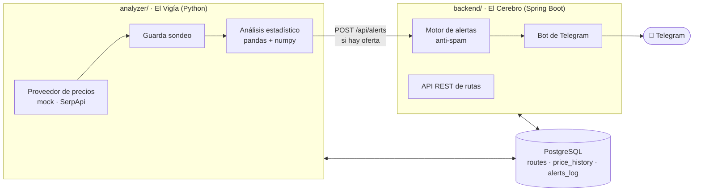

# ✈️ Viajesito — Asistente personal de alertas y análisis de vuelos

Sistema privado que vigila precios de vuelos, guarda el histórico, lo analiza con
`pandas`/`numpy` y te avisa por **Telegram** cuando detecta una ganga.



| Módulo | Responsabilidad | Tablas |
|---|---|---|
| `db/` | Esquema y datos de ejemplo (se aplican al crear el volumen) | — |
| `analyzer/` (Python) | Lee rutas activas, consulta precios, guarda el sondeo, calcula estadísticas y detecta ofertas | lee `routes`, escribe `price_history` |
| `backend/` (Java) | CRUD de rutas, consulta de histórico, anti-spam, envío a Telegram | `routes`, lee `price_history`, escribe `alerts_log` |

---

## 🚀 Puesta en marcha (Docker)

Requisitos: Docker Desktop.

```bash
cp .env.example .env
```

```bash
docker compose up -d --build
```

Eso levanta PostgreSQL, el backend en `http://localhost:8080` y el analizador, que
hace una corrida al arrancar y después una por día a la hora `RUN_AT`. Sin
configurar nada más ya funciona con **precios simulados** y alertas en modo
`DRY_RUN` (se registran y se ven en los logs, pero no se envían).

> Si ya tenés un PostgreSQL local en el puerto 5432, poné `POSTGRES_PORT=5433` en el `.env`.

Para probar el análisis sin esperar semanas de datos, generá un histórico simulado y corré el vigía:

```bash
docker compose exec analyzer python -m vigia backfill --days 60
```

```bash
docker compose exec analyzer python -m vigia run
```

```bash
docker compose logs -f backend
```

### 📱 Conectar Telegram

1. En Telegram, hablale a [@BotFather](https://t.me/BotFather), mandá `/newbot` y copiá el **token**.
2. Mandale cualquier mensaje a tu bot nuevo.
3. Abrí `https://api.telegram.org/bot<TOKEN>/getUpdates` en el navegador y buscá `"chat":{"id": ...}`: ese es tu **chat_id**.
4. Completá `TELEGRAM_BOT_TOKEN` y `TELEGRAM_CHAT_ID` en el `.env` y recreá el backend:

```bash
docker compose up -d backend
```

```bash
curl -X POST http://localhost:8080/api/telegram/test
```

Ejemplo de alerta:

```
✈️ ¡Precio anómalo!
EZE → MAD · ida y vuelta
📅 sáb 30 ene 2027 → vie 19 feb 2027
💰 USD 1.288,02 · American Airlines · 1 escala
📉 14,9% por debajo del promedio (USD 1.513,56)
⚡ Precio anómalo: 2,1 desvíos estándar bajo la media
📊 Mediana USD 1.528,12 · 61 días de histórico · tendencia ↗ subiendo
Ver en Google Flights
```

### 🌐 Precios reales (SerpApi · Google Flights)

> La API Self-Service de Amadeus, la opción gratuita clásica, se dio de baja en julio de 2026.

1. Creá una cuenta en [serpapi.com](https://serpapi.com). El plan gratuito trae 250 búsquedas/mes, o sea ~8 rutas con un sondeo diario.
2. En el `.env`: `PRICE_PROVIDER=serpapi` y `SERPAPI_API_KEY=...`.
3. `docker compose up -d analyzer`

Con un proveedor real, el análisis **ignora** los precios simulados (`source` que empieza con `mock`).
Para borrarlos igual:

```bash
docker compose exec db psql -U viajesito -c "DELETE FROM price_history WHERE source LIKE 'mock%';"
```

Para sumar otro proveedor: implementá `PriceProvider` (un método `fetch_lowest(route)`) en
`analyzer/vigia/providers/` y registralo en `get_provider`.

---

## 🧠 Cómo decide qué es una oferta

El analizador ([analysis.py](analyzer/vigia/analysis.py)) reduce el histórico a **un precio por día**
(el mínimo), excluye el día actual y compara el precio nuevo contra eso:

| Señal | Condición | Configuración |
|---|---|---|
| `HISTORICAL_MIN` | precio ≤ mínimo histórico **y** ahorro ≥ `MIN_SAVINGS_PCT` | `MIN_SAVINGS_PCT=5` |
| `ANOMALY` | z-score ≤ −`ZSCORE_THRESHOLD` **y** ahorro ≥ `MIN_SAVINGS_PCT` | `ZSCORE_THRESHOLD=2.0` |
| `BELOW_AVERAGE` | precio al menos X% por debajo del promedio | `DEAL_THRESHOLD_PCT=15` |
| `TARGET_PRICE` | precio ≤ `target_price_max` de la ruta (no requiere histórico) | por ruta |

Las tres primeras se activan recién con `MIN_SAMPLES` días de histórico (5 por defecto).
El ahorro mínimo evita que una ruta muy estable dispare "mínimo histórico" por bajar 3 dólares.
También se calcula mediana, desvío, coeficiente de variación y la **tendencia** de los últimos 14 días
(regresión lineal con `numpy.polyfit`).

### Anti-spam (backend)

[AlertService](backend/src/main/java/com/viajesito/alert/AlertService.java) recuerda la última alerta
de cada ruta (`alerts_log`). Dentro de `ALERT_COOLDOWN_HOURS` (72 h) solo vuelve a avisar si el precio
bajó al menos `ALERT_MIN_IMPROVEMENT_PCT` (3%). Tampoco avisa sobre rutas pausadas. Los envíos que
fallan (`FAILED`) no cuentan, así que se reintentan en la próxima corrida.

---

## 🔌 API REST

Ejemplos listos para usar en [requests.http](requests.http).

| Método | Ruta | Descripción |
|---|---|---|
| `GET` | `/api/routes?active=true` | Listar rutas |
| `POST` | `/api/routes` | Crear ruta |
| `GET` / `PUT` / `DELETE` | `/api/routes/{id}` | Ver, reemplazar o borrar |
| `POST` | `/api/routes/{id}/pause` · `/resume` | Pausar o reanudar la vigilancia |
| `GET` | `/api/routes/{id}/prices?limit=30` | Últimos sondeos |
| `GET` | `/api/routes/{id}/stats` | Promedio, mediana, mín., máx., último |
| `POST` | `/api/alerts` | Recibe una oferta (lo usa el analizador) |
| `GET` | `/api/alerts?routeId=&limit=` | Historial de alertas |
| `POST` | `/api/telegram/test` | Mensaje de prueba |
| `GET` | `/actuator/health` | Estado del backend |

Ruta de ejemplo:

```json
{
  "origin": "EZE", "destination": "BCN",
  "departureDate": "2027-04-10", "returnDate": "2027-04-28",
  "currency": "USD", "adults": 1,
  "targetPriceMin": 850, "targetPriceMax": 1050,
  "notes": "Semana Santa"
}
```

`returnDate` vacío = solo ida. `targetPriceMax` es el umbral "me sirve" y `targetPriceMin` el "precio soñado".

**Seguridad:** si definís `APP_API_KEY` en el `.env`, todas las rutas `/api/**` exigen el header
`X-Api-Key` (el analizador lo manda solo). El backend está pensado para uso local: no lo expongas a internet.

---

## 🛠️ Desarrollo local (sin contenedores para el código)

Levantá solo la base:

```bash
docker compose up -d db
```

**Python** (desde `analyzer/`, lee el `.env` de la raíz):

```bash
python -m venv .venv
```

```bash
.venv/Scripts/pip install -r requirements-dev.txt
```

```bash
.venv/Scripts/python -m pytest
```

```bash
.venv/Scripts/python -m vigia run --dry-run
```

| Comando | Qué hace |
|---|---|
| `python -m vigia run [--route ID] [--dry-run] [--force]` | Una corrida. Cada ruta se consulta como máximo una vez por día (`--force` lo saltea). `--dry-run` no escribe en la base y muestra las ofertas por consola |
| `python -m vigia schedule` | Corre todos los días a `RUN_AT` |
| `python -m vigia stats [--route ID]` | Tabla de estadísticas por ruta |
| `python -m vigia backfill --days 60` | Histórico simulado para pruebas |

`NOTIFIER=console` permite usar el analizador sin el backend (Fase 2).

**Java** (desde `backend/`, también lee el `.env` de la raíz):

```bash
./mvnw test
```

```bash
./mvnw spring-boot:run
```

---

## 🗂️ Estructura

```
viajesito/
├── docker-compose.yml
├── .env.example
├── requests.http
├── db/init/
│   ├── 01_schema.sql        # routes, price_history, alerts_log
│   └── 02_seed.sql          # 3 rutas de ejemplo
├── analyzer/                # Python
│   └── vigia/
│       ├── __main__.py      # CLI
│       ├── runner.py        # recolectar → guardar → analizar → notificar
│       ├── analysis.py      # estadísticas y detección de ofertas
│       ├── providers/       # mock, serpapi
│       ├── notifier.py      # backend Java o consola
│       ├── scheduler.py     # ejecución diaria
│       └── db.py
└── backend/                 # Spring Boot 4 / Java 21
    └── src/main/java/com/viajesito/
        ├── route/           # CRUD de rutas
        ├── price/           # histórico y estadísticas
        ├── alert/           # anti-spam, formato y registro de alertas
        ├── telegram/        # cliente de la Bot API
        └── common/          # errores, filtro de API key
```

## 🔄 Mantenimiento

| Necesito... | Comando |
|---|---|
| Ver logs | `docker compose logs -f analyzer backend` |
| Detener todo (conserva datos) | `docker compose stop` |
| Re-crear la base desde cero (**borra todo**) | `docker compose down -v` y después `docker compose up -d` |
| Aplicar cambios de código | `docker compose up -d --build` |

El esquema se aplica solo al crear el volumen. Si cambiás `db/init/01_schema.sql` con datos que querés
conservar, aplicá el `ALTER TABLE` a mano. El backend valida al arrancar que el esquema coincida con las entidades.
